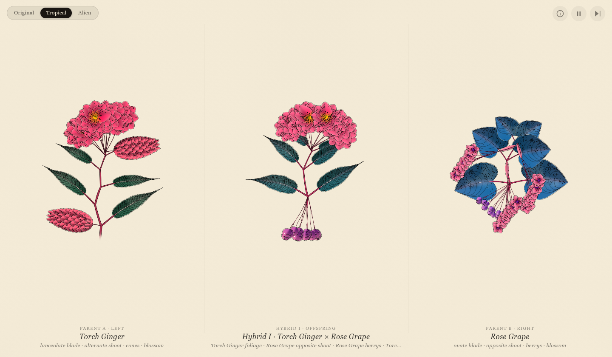

# Hybridizer

**Botanical hybridisation and procedural plant breeding study.**

👉 **[Launch Hybridizer Live](https://billtribble.github.io/hybridizer/)** · **[Design & Creative Technology Portfolio](https://billtribble.com/design)**

## Features
- **Procedural Botanical Growth & Cross-Breeding**: Continuous botanical cross-pollination of parent specimens across generations with real-time 2D WebGL2 watercolour geometry and shaders.
- **Three Flora Biomes (132 Species)**:
  - **Tropical** — 44 exotic flower species with multi-ring blossoms and tropical botanical watercolour gradients.
  - **Original (European)** — 44 Western European trees and shrubs inspired by [Jack Bush's Sprig](https://jackbush.github.io/glimmers/sprig/).
  - **Alien** — 44 psychedelic xenobotanical species with iridescent phase-wave shaders and spiraling tendrils.
